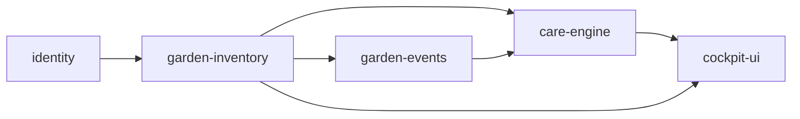

# Capability Map: Viridarium Garden Care Cockpit

Initiative decomposing the garden care cockpit into bounded, independently testable full-stack modules.

| Module id | Responsibility | Depends on |
|---|---|---|
| `identity` | Instance bootstrap admin, user credentials, secure HTTP-only session auth, user tenant isolation. | — |
| `garden-inventory` | Section grids (e.g. Front Yard, Veggie Patch), orientation landmarks, plant registry with care rules. | `identity` |
| `garden-events` | Immutable append-only log of care activities (`WATER`, `PESTICIDE`, `PRUNE`). | `identity`, `garden-inventory` |
| `care-engine` | Pure care state projections: hydration overdue check, pesticide safety lockout countdown, pruning alerts. | `garden-inventory`, `garden-events` |
| `cockpit-ui` | Mobile PWA cockpit: 'Today' action list with 1-tap zone batching, section grid viewer, offline status. | `care-engine`, `garden-inventory` |

## Build Order

Build order: `identity` → `garden-inventory` → `garden-events` → `care-engine` → `cockpit-ui`
