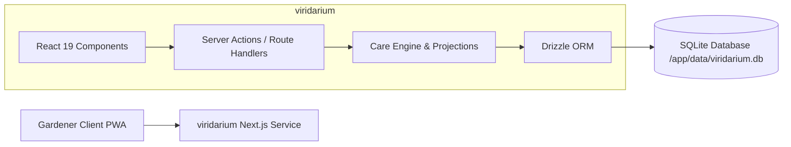

# Viridarium Architecture

## Purpose

Viridarium is a self-hosted garden management system providing an operational care cockpit and 2D spatial layout.

## Architecture Principles

- **Single Container Deployment:** Full-stack Next.js application embedding UI, domain engine, and API routes.
- **Embedded Zero-Ops Persistence:** SQLite database stored on a mounted local volume (`/app/data/viridarium.db`).
- **Immutable Care Event Stream:** Care actions logged as append-only records to enable flexible domain projections without schema migrations.
- **Strict User Isolation:** Single-instance multi-user support with all entities partitioned by `user_id`.
- **Two-Tier Quality Gates:** Fast in-memory server testing via Vitest paired with headless mobile browser integration via Playwright.

## Service Landscape

| Service | Status | Responsibility | Interface |
|---|---|---|---|
| `viridarium` (`service/`) | Active | Full-stack Next.js application (UI, server actions, ORM, SQLite) | HTTP/HTTPS |

## System Context

## Runtime Connections

1. Client interacts with mobile-responsive Next.js interface.
2. Authenticated requests pass session cookies to Next.js server actions.
3. Server actions invoke domain logic, projecting care states (hydration, pesticide lockouts) on-demand from SQLite.

## Testing Architecture

- **Tier 1 (Server Integration & Unit):** Vitest executes in-process against `:memory:` SQLite for business logic, cryptography, and queries.
- **Tier 2 (Browser Integration & E2E):** Playwright executes user journeys on mobile viewports (Chromium, WebKit) against a running Next.js instance.
