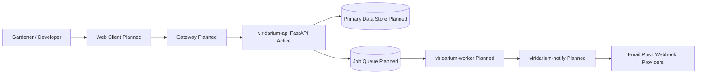

# Viridarium Architecture

## Purpose

Viridarium is a modular garden management system for planning, tracking, and operating a home or community garden. The architecture is service-oriented and intentionally incremental: backend API first, then additional services as product needs mature.

## Architecture Principles

- Incremental delivery: introduce one service at a time with stable interfaces
- Clear bounded contexts per service
- API-first integration between user-facing clients and backend services
- Replaceable components so new services can be added without breaking existing flows

## Service Landscape

| Service                                     | Status  | Responsibility                                                | Main Interfaces                   |
| ------------------------------------------- | ------- | ------------------------------------------------------------- | --------------------------------- |
| `viridarium-api` (FastAPI)                  | Active  | Core domain API, request validation, orchestration entrypoint | HTTP/JSON                         |
| Web frontend (`viridarium-web`)             | Planned | User-facing dashboard and workflows                           | HTTP to API                       |
| Worker service (`viridarium-worker`)        | Planned | Background jobs (reminders, sync, recurring tasks)            | Queue/events + API/internal DB    |
| Identity/access service (`viridarium-iam`)  | Planned | Authentication, authorization, session/token handling         | Auth endpoints + token validation |
| Gateway/edge service (`viridarium-gateway`) | Planned | Unified public ingress, routing, rate-limits, TLS termination | HTTPS ingress                     |

Current implementation only includes `viridarium-api`. Planned services are architecture targets, not yet implemented.

## System Context

## Runtime Connections

1. Users interact with the web client (planned).
2. The web client sends authenticated HTTP requests through the gateway (planned) to `viridarium-api`.
3. `viridarium-api` validates input, applies business rules, and reads/writes domain state.
4. Long-running or scheduled work is delegated to worker/notification services once they are introduced.

## Core Workflows

To be created

## Deployment View (High Level)

- Current local runtime supports API-only execution via two paths:
1. Direct uv workspace path from repo root (`uv sync` then `uv run fastapi dev --port 8700`)
2. Containerized path via root compose file and `api/Dockerfile` (`docker compose --profile optional up --build api`)
- Future default stack is expected to include API + frontend + persistence + worker pipeline.
- Infrastructure concerns (network, secrets, observability) will be introduced alongside each new service.

## Evolution Strategy

- Keep API contracts versioned and backward-compatible when possible.
- Add planned services behind explicit boundaries rather than embedding responsibilities into API.
- Update this architecture document whenever a service is added, removed, or materially re-scoped.

