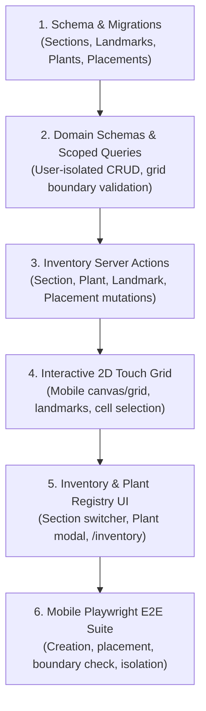

# Implementation Plan: garden-inventory Module

Technical execution plan for multi-section 2D grids, landmarks, and botanical inventory in `service/`.

## Component Architecture & Dependencies

## Implementation Phases

### Phase 1: Data Model & Schema
- Define Drizzle SQLite schema for `sections`, `landmarks`, `plants`, `placements` in `src/db/schema/inventory.ts`.
- Add unique constraints `(section_id, x, y)` and foreign keys with cascade deletes.
- Generate migrations and verify with in-memory SQLite tests.

### Phase 2: Domain Logic & Tenant Queries
- Implement Zod schemas in `src/lib/inventory/schemas.ts`.
- Implement scoped queries in `src/lib/inventory/queries.ts` ensuring zero cross-tenant data leaks.
- Implement server actions in `src/lib/inventory/actions.ts` with coordinate bounds checks.
- Verify with unit tests in `tests/unit/inventory/`.

### Phase 3: Mobile 2D Grid & Inventory Pages
- Build `SectionGrid` touch component rendering landmarks and plant markers on cell coordinates.
- Build `/inventory` view with section switcher and cell action sheet.
- Build `/inventory/plants` botanical registry with care parameter editing.

### Phase 4: E2E Verification
- Playwright mobile test verifying: create section $\rightarrow$ create landmark $\rightarrow$ create plant $\rightarrow$ place on grid $\rightarrow$ verify tenant isolation.

## Verification Checkpoints

1. **Checkpoint 1 (Unit & Boundaries):** In-memory tests verify grid coordinate checks (`0 <= x < width`), collision rules, and tenant query scoping.
2. **Checkpoint 2 (Build & Lint):** `pnpm lint` and `pnpm build` pass with 0 warnings/errors.
3. **Checkpoint 3 (E2E Integration):** Playwright mobile test passes section and plant placement flow on Pixel 7 viewport.
