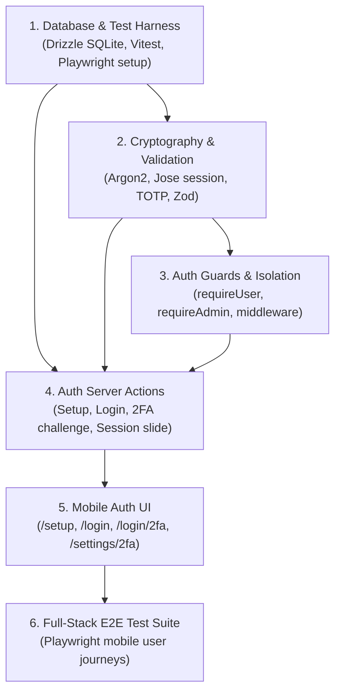

# Implementation Plan: identity Module

Technical execution plan for instance bootstrap, user authentication, TOTP 2FA, and tenant isolation in `service/`.

## Component Architecture & Dependencies

## Implementation Phases

### Phase 1: Tooling & Data Foundation
- Install runtime and dev dependencies (`better-sqlite3`, `drizzle-orm`, `@node-rs/argon2`, `jose`, `otplib`, `qrcode`, `zod`, `vitest`, `@playwright/test`).
- Establish Drizzle SQLite schema for `users` and `sessions` with migrations.
- Configure Vitest in-memory SQLite helper (`:memory:`) for fast server tests.

### Phase 2: Cryptographic Primitives & Validation
- Implement `password.ts`: 12+ character complexity Zod schema, Argon2id hash & verify.
- Implement `totp.ts`: Secret generation, QR code data URL, 6-digit token verification.
- Implement `session.ts`: Jose session sealing, unsealing, 30-day sliding refresh logic.
- Verify with unit test suite in Vitest.

### Phase 3: Auth Guards & Server Actions
- Implement `guard.ts`: `requireUser()` and `requireAdmin()`.
- Implement Server Actions: `setupAdminAction`, `loginAction`, `verify2faAction`, `enable2faAction`, `logoutAction`.
- Protect routes: `/setup` locked when users exist; unauthenticated requests routed to `/login`.

### Phase 4: UI & E2E Verification
- Build mobile-optimized UI forms: `/setup`, `/login`, `/login/2fa`, `/settings/2fa`.
- Write Playwright E2E spec verifying complete mobile user journey.

## Risks & Mitigations

| Risk | Impact | Mitigation |
|---|---|---|
| Insecure LAN deployment | Web Push / PWA fails without HTTPS | Next.js dev server runs with `--experimental-https`; docs detail reverse proxy. |
| User enumeration attacks | Security vulnerability | Constant-time password checks and generic error messages ("Invalid credentials"). |
| 2FA lockouts | User loses access | Generate backup recovery codes during 2FA activation. |

## Verification Checkpoints

1. **Checkpoint 1 (Unit/Crypto):** `pnpm test` passes 100% of password, session, and TOTP tests.
2. **Checkpoint 2 (Server Integration):** In-memory test verifies setup lockout and `requireUser()` tenant boundaries.
3. **Checkpoint 3 (E2E Integration):** `pnpm test:e2e` passes mobile flow from setup through 2FA login.
